# Missão Escola — pontos de confusão antes do beta

Revisão de usabilidade do Missão Escola — preparação para o beta. Prints feitos em 05/11/2026 a partir do projeto atual executado localmente. Percurso com navegador novo, sem conta, em 390 × 844 e 1366 × 900. As chamadas ao Supabase foram bloqueadas para não usar dados reais. Esta é uma inspeção da interface e do fluxo, não um teste com alunos reais nem uma confirmação do estado de produção.

O botão principal no topo já é uma melhoria. O trabalho prioritário agora é manter a continuidade entre começar, responder e concluir, sem exigir que o aluno interprete o funcionamento do sistema.

## 1. A pergunta e as respostas precisam aparecer primeiro

**Prioridade:** Alta

**O que pode confundir:** Antes da pergunta, o aluno encontra o roteiro do estudo, “Checagem curta · ainda temos poucas evidências”, outro título, dificuldade e a quantidade de questões do banco. No celular, as alternativas ficam fora da primeira tela. A identificação da matéria também está clara demais sobre fundo claro.

**O que mudar:** Mostrar “Questão 1 de 3”, o enunciado e as alternativas como conteúdo principal. Recolher explicações do sistema em “Sobre esta atividade”, tirar a quantidade total de questões do caminho e escurecer os textos. A pergunta opcional sobre confiança pode ficar depois da resposta.

**Como conferir:** O aluno consegue localizar a pergunta e as primeiras alternativas sem atravessar blocos introdutórios; textos informativos têm contraste legível.

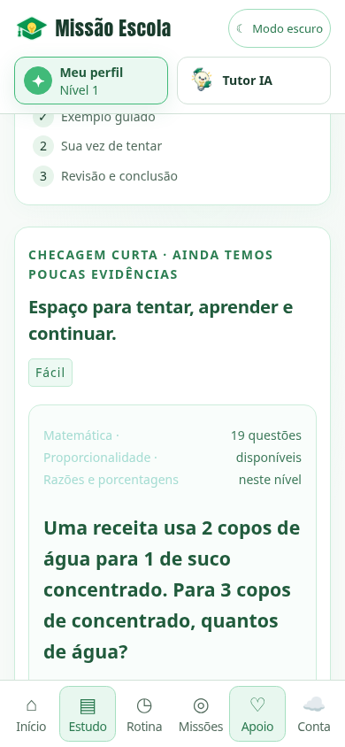

## 2. O ano escolar é presumido e fica escondido

**Prioridade:** Alta

**O que pode confundir:** Sem perfil preenchido, a seleção inicial é 7º ano. Essa informação aparece dentro de “Trocar matéria”, abaixo do bloco de começar. Um aluno de outro ano pode iniciar conteúdo inadequado sem perceber.

**O que mudar:** Na primeira visita, perguntar apenas “Em que ano você está?” antes de preparar o estudo. Mostrar a escolha ao lado da matéria com o link “Trocar”. Deixar nome, idade e dificuldades para uma personalização opcional posterior.

**Como conferir:** Uma pessoa nova consegue identificar e escolher seu ano sem procurar o formulário completo de perfil.

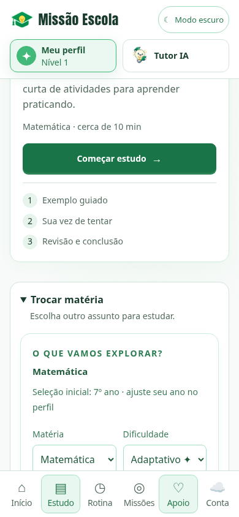

## 3. Os caminhos para estudar não levam sempre ao mesmo lugar

**Prioridade:** Alta

**O que pode confundir:** No teste com navegador novo, o início sugeriu Artes; entrar pela aba Estudo mostrou Matemática. Depois de responder uma questão, “Continuar estudo” na página inicial abriu outra tela com mais um botão “Continuar estudo”, em vez de retomar diretamente a próxima questão.

**O que mudar:** Usar a mesma sugestão e a mesma seleção em todos os pontos de entrada. Fazer “Continuar estudo” abrir exatamente a atividade pendente; oferecer “Ver meu plano” como ação secundária.

**Como conferir:** Os dois caminhos iniciais preservam a matéria escolhida e a retomada exige um único clique.

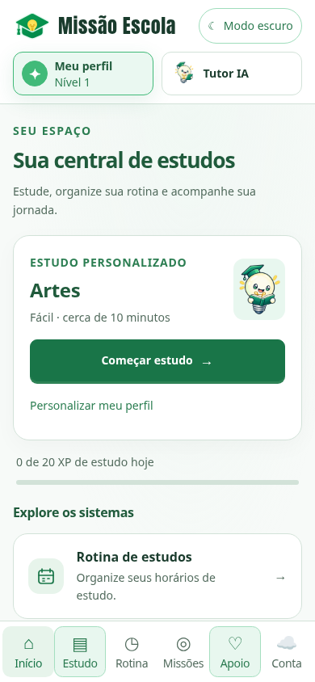

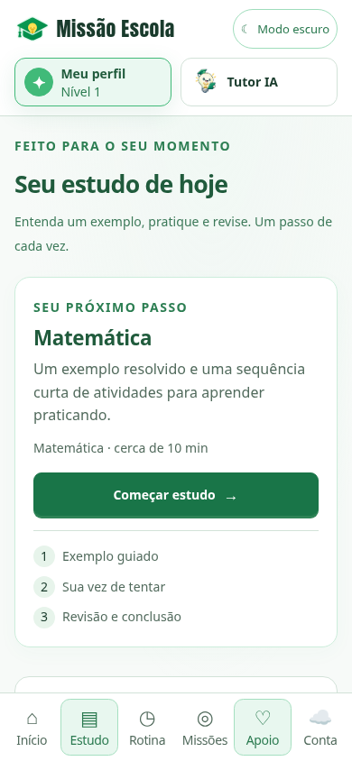

## 4. O botão do exemplo e os avisos de XP competem com a aprendizagem

**Prioridade:** Alta

**O que pode confundir:** O botão “Registrar revisão · +15 XP” não explica claramente que abre a prática. O aviso temporário “Meta diária conquistada” apareceu quando o estudo estava começando e cobriu parte do conteúdo. Para quem não conhece o sistema, isso pode sugerir que já terminou.

**O que mudar:** Renomear o botão para “Entendi, ir para a prática”. Mostrar XP de forma discreta depois da ação, sem cobrir o enunciado ou o exemplo. Distinguir a meta de pontos da conclusão do estudo; deixar claro que ainda há questões a responder.

**Como conferir:** O aluno entende para onde o botão leva e recebe recompensas sem perder a leitura do conteúdo.

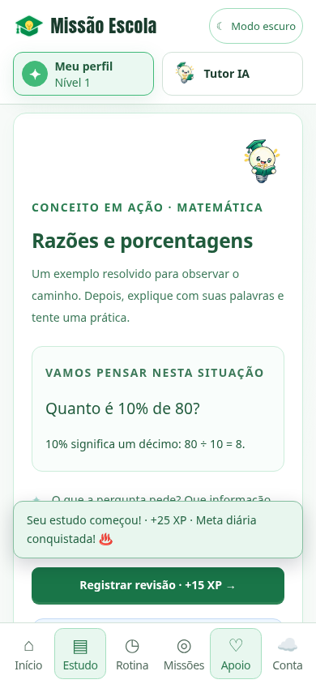

## 5. Concluir ainda exige interpretar uma segunda tela

**Prioridade:** Alta

**O que pode confundir:** Depois da última questão, o fluxo retorna à visão geral. Há um botão “Concluir estudo” no topo e outro depois de uma lista longa de etapas com “Revisitar”. O botão existe, mas a passagem de última resposta para resultado final continua indireta.

**O que mudar:** Ao terminar a última questão, salvar a conclusão e apresentar imediatamente “Estudo concluído: 3 de 3 questões”. Exibir um próximo passo principal, como “Voltar ao início”, e deixar “Rever questões” como alternativa.

**Como conferir:** A última resposta leva a um resultado inequívoco sem procurar outro comando de conclusão.

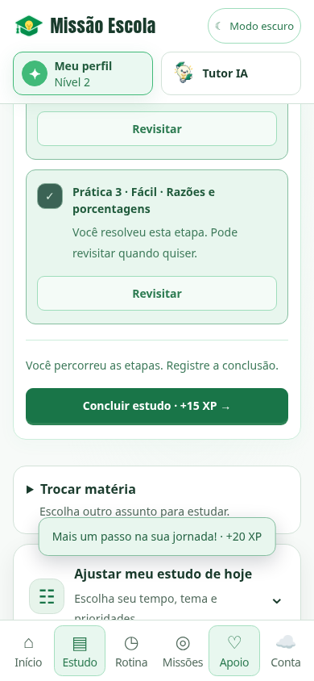

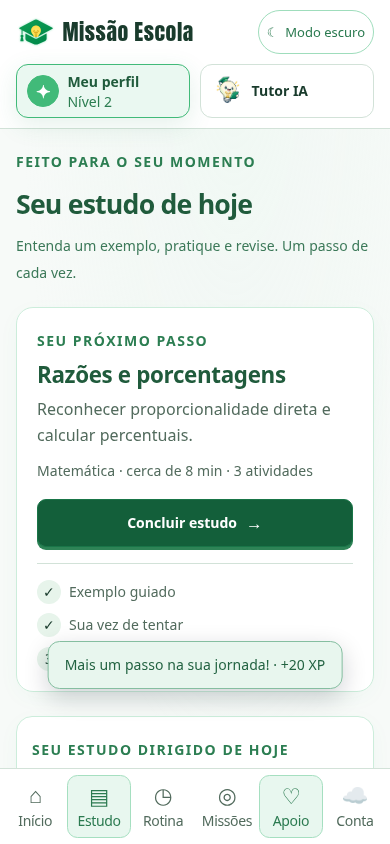

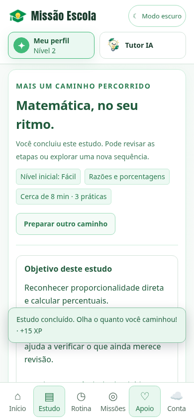

## 6. O cabeçalho ocupa espaço demais e quebra no celular

**Prioridade:** Alta

**O que pode confundir:** Nas abas Rotina e Apoio, após aparecerem os indicadores de progresso, o nome Missão Escola quebra em várias linhas. Cabeçalho, atalhos e contadores consomem boa parte da tela antes do conteúdo útil.

**O que mudar:** Manter logo e nome em uma linha, reduzir os atalhos superiores e levar os contadores para a área de progresso. Preservar apenas uma indicação visual clara da aba atual no menu inferior.

**Como conferir:** Em telas de 390 px, o nome não quebra e o título e a primeira ação útil da aba aparecem sem uma grande faixa de navegação.

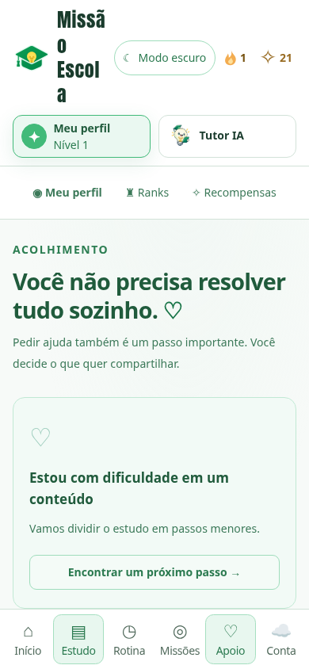

## 7. O Tutor abre com aparência de conversa, mas depende de conta

**Prioridade:** Alta

**O que pode confundir:** Sem autenticação, o Tutor mostra uma grande área vazia e o campo de mensagem. A exigência de entrar na conta aparece perto da parte inferior. Além disso, “Meu perfil” e “Minha conta” são áreas diferentes, o que pode confundir quem acabou de preencher seus dados escolares.

**O que mudar:** Quando não houver login, mostrar no centro “Entre para conversar com o Tutor” com um botão principal “Entrar ou criar conta”. Explicar em uma frase que perfil escolar define os conteúdos e conta permite usar o Tutor e salvar entre aparelhos. Após o login, devolver o aluno à atividade em que estava.

**Como conferir:** A pessoa entende o requisito antes de tentar escrever e consegue voltar à dúvida sem refazer a navegação.

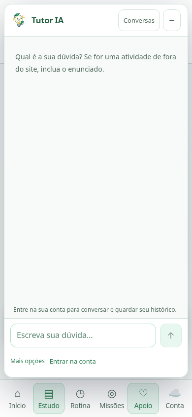

## 8. Montar a rotina exige muitas decisões de uma vez

**Prioridade:** Média

**O que pode confundir:** A aba começa com duas formas de montar a rotina e segue para um formulário extenso de horários. O aluno ainda precisa entender a diferença entre sugestão, prévia e rotina salva. “Gerar com IA adaptativa” explica a tecnologia, mas não simplifica a escolha.

**O que mudar:** Usar três passos curtos: “Escolha os dias”, “Escolha um horário”, “Confira sua semana”. Oferecer “Quero uma sugestão” e “Quero escolher meus horários”. Deixar compromissos e ajustes detalhados em “Mais ajustes”; confirmar com uma única ação evidente “Salvar minha rotina”.

**Como conferir:** Um aluno novo consegue montar a primeira semana sem compreender termos técnicos ou percorrer todo o formulário de uma vez.

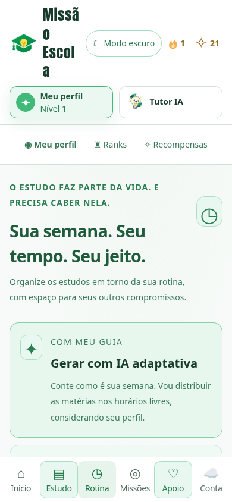

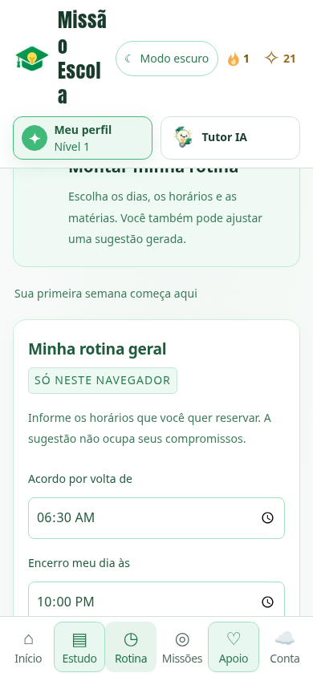

## 9. O apoio ainda não gera um pedido real

**Prioridade:** Alta antes de oferecer atendimento

**O que pode confundir:** O formulário informa que é simulado e não envia dados à escola. O aviso está presente, mas um aluno que procura ajuda ainda encontra um formulário sem atendimento ao final.

**O que mudar:** Enquanto não houver atendimento configurado, substituir o formulário por uma explicação direta e um caminho real de ajuda. Quando o canal existir, informar antes de escrever quem recebe, como acompanha e o que acontece depois do envio.

**Como conferir:** O aluno distingue claramente uma demonstração de um pedido real e encontra uma próxima ação útil ao procurar ajuda.

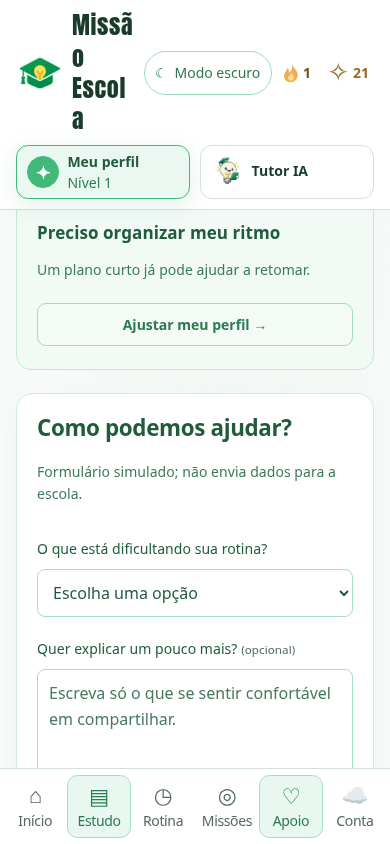

## Sequência de trabalho

Ordem sugerida: simplificar a questão e escolher o ano; unificar entrada e retomada; esclarecer avanço e conclusão; corrigir o cabeçalho; esclarecer o acesso ao Tutor e o apoio; simplificar a rotina. Antes de abrir o beta, testar com 3 a 5 alunos pouco acostumados com tecnologia: começar um estudo, responder, sair, continuar, concluir e pedir ajuda, sem orientação do adulto. Observar onde param e se conseguem explicar o próximo passo. Nenhuma alteração de código ou publicação foi feita nesta análise.
